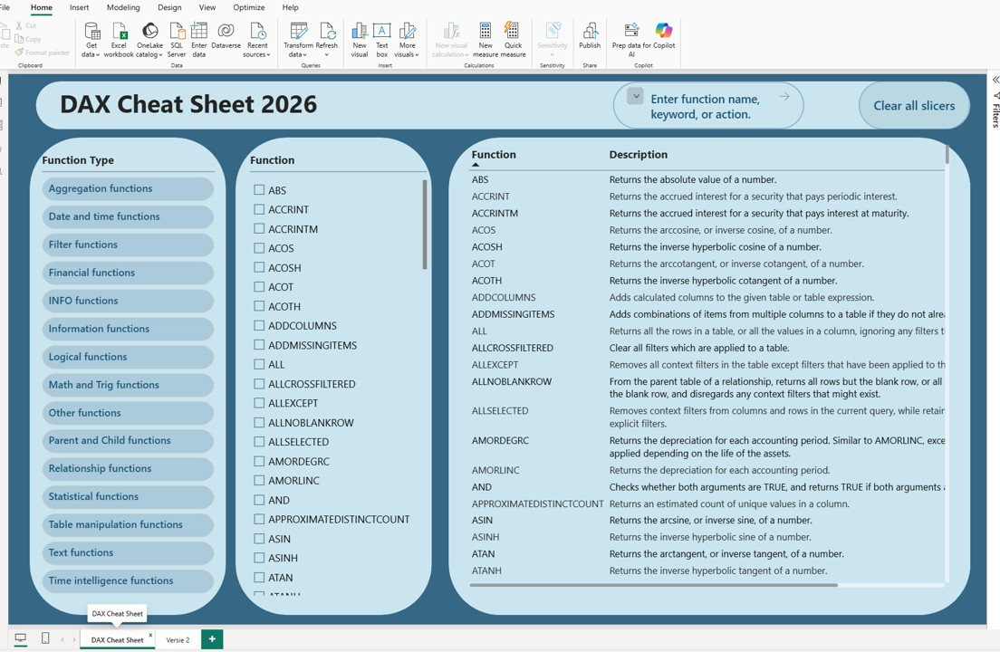

# DAX Cheat Sheet 2026 | Interactive Power BI Reference Guide

## 📌 Project Overview
An interactive and user-friendly reference dashboard designed for data analysts to quickly navigate, search, and learn DAX (Data Analysis Expressions) functions in Power BI. It helps users filter functions by categories, search by keywords, and read descriptions on the fly.

## 🛠️ Features & Implementation:
* **Interactive Slicers:** Easily filter functions by their specific types (e.g., Date and Time, Financial, Logical, Statistical, etc.).
* **Search Bar Functionality:** Built-in text search to instantly find any DAX function by its name or description.
* **UI/UX Design:** A clean, minimalist, and high-contrast layout optimized for comfortable daily use as a quick-reference tool.

## 📊 Dashboard Interface

## 📂 How to Use This Project Locally:
1. Download the `Dax functions cheat sheet Daria2026 .pbix` file from this repository.
2. Open it using *Power BI Desktop*.
